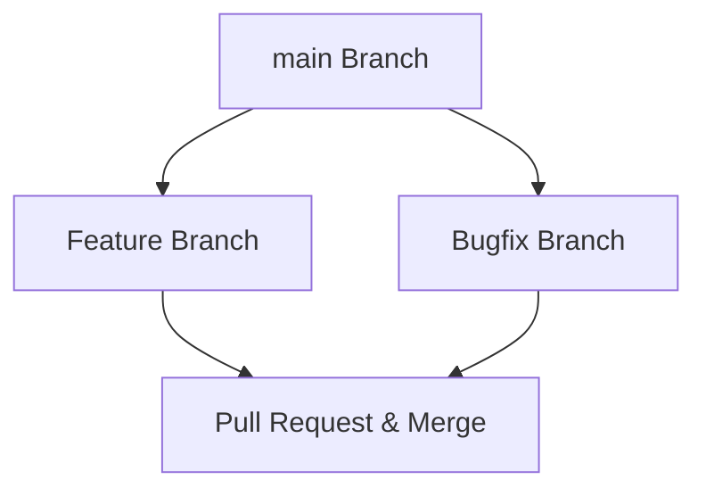

# This is a Blog for Learning Github for Beginners/Developers
## Planning
### Session-6

<!-- How to Add Image -->


<!-- How to Enter Ordered List -->
- [ ] Check out the [github blog](https://github.blog/) for topic ideas.
- [ ] Learn about [GitHub Pages](https://skills.github.com/#first-day-on-github).
- [ ] Convert my first blog post into an actual webpage.

<!-- How to Enter Expand List -->
<details open>
<summary>My top languages to use in GITHUB</summary>

<!-- How to Enter Table -->
| Rank | *Languages* |
|-----:|-----------|
|     1| **Scratch**   |
|     2| **Python**    |
|     3| **Java**      |
</details>

---
<!-- How to Enter Quotes -->
> Today's Quote : The best error message is the one that never shows up!!

<!-- How to Enter Alerts -->
> [!NOTE]
> Here you will find all the important notes.

> [!TIP]
> Helpful advice for doing things better or more easily.

> [!IMPORTANT]
> Key information users need to know to achieve their goal.

> [!WARNING]
> Urgent info that needs immediate user attention to avoid problems.

> [!CAUTION]
> Advises about risks of certain actions for which we need to be careful.

<!-- How to Enter Emojis -->
@Yash :+1: This looks good for the Github training! :wave:

<!-- How to Enter Review -->
## Review
Convert an image or video from dark mode to light mode using [ffmpeg](https://www.ffmpeg.org)

```bash
ffmpeg -i input.mp4 -vf "negate,hue=h=180,eq=contrast=1.2:saturation=1.1" output.mp4
```

### Session-7
-----------------
<!-- How to Enter URL's  -->
###### How to Enter URL
Visit https://github.com


<!-- How to Enter Flowchart using Code Block -->
###### How to Enter Flowchart



<!-- How to Use Mathematical Expressions -->
###### How to Enter Mathematical Expression

**To Display Mathematical Expression**

$$
\sqrt{3x-1}+(1+x)^2
$$
